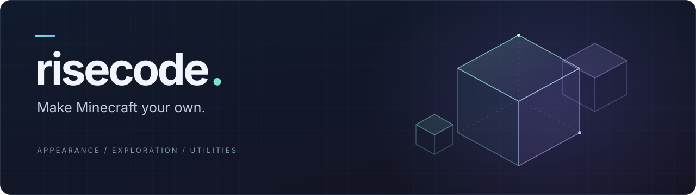

<p align="center">
  
</p>

<p align="center">
  <strong>A modular Minecraft client with a fluid interface, expressive visuals, and tools for your world.</strong>
</p>

<p align="center">
  
  
  
  
  <a href="LICENSE"></a>
</p>

<p align="center">
  <a href="#getting-started">Get started</a> ·
  <a href="docs/usage.md">User guide</a> ·
  <a href="CHANGELOG.md">Changelog</a> ·
  <a href="docs/releases/README.md">All 42 versions</a> ·
  <a href="https://github.com/aidentallen/risecode/issues">Report an issue</a>
</p>

## Your world, your setup

risecode brings appearance controls, maps, cosmetics, and gameplay utilities into
one client-side Fabric mod. Open the interface with **Right Shift**, choose the
features you want, and save your setup in profiles.

| | What you can do |
| :--- | :--- |
| **Make it yours** | Edit fonts, colors, gradients, blur, glow, backgrounds, sounds, and animation. Arrange your HUD and save independent appearance profiles. |
| **Change the atmosphere** | Explore an optional resource-pack-aware Living Panorama, customize Ambience, and animate newly loaded terrain and placed blocks. |
| **Add a little Glass** | Apply clear, tinted, or frosted materials to players and equipment, with independent targets, material overrides, and a live preview. |
| **Find your way** | Use surface and cave maps, a movable world map, waypoints, and death history. Exploration persists per world and dimension. |
| **Build an outfit** | Browse capes, wings, headwear, companions, and effects in the Cosmetics wardrobe. Import PNG capes and enable optional legacy cape motion. |
| **Bring your tools** | Configure camera and render utilities, block highlights, chat and tab styling, hotbar tools, gameplay modules, and optional Baritone controls. |

**Resources** adds a Vanilla Tweaks picker with previews, selection priority,
compatibility notices, and an offline cache. Its downloaded assets remain in your
personal game directory.

## Recently added

- **[0.27.0 · Glass](docs/releases/v0.27.0.md)** — material presets, frosted
  refraction, luminous edges, shimmer, and a rotatable equipment preview.
- **[0.26.0 · Living Panorama](docs/releases/v0.26.0.md)** — a forest-and-lake
  title scene with six atmospheres, foliage wind, water ripples, and quiet ambience.
- **[0.25.0 · Rendering & typography](docs/releases/v0.25.0.md)** — chest
  placement motion, bundled Qraftys, font boldness, and independent world resolution
  with Bilinear or AMD FSR1 upscaling.

Read the [complete changelog](CHANGELOG.md) or browse the
[version-by-version history](docs/releases/README.md), from **0.1.0 to 0.27.0**.

## Getting started

| Requirement | Version |
| :--- | :--- |
| Minecraft | **26.2** |
| Java | **25 or newer** |
| Fabric Loader | **0.19.5 or newer** |
| Fabric API | **0.161.0+26.2 or newer**, for Minecraft 26.2 |

1. Prepare a Fabric instance with the requirements above.
2. [Build the project](#build-from-source) and copy
   `build/libs/riserecode-0.27.0.jar` into the instance's `mods/` directory.
   Use the release JAR; the separate sources JAR is for development.
3. Restart Minecraft and press **Right Shift**. The title-screen interface button
   also opens risecode.

The current version is available in source. Consult
[GitHub Releases](https://github.com/aidentallen/risecode/releases) for published
downloads when available.

### A few useful controls

| Action | Control |
| :--- | :--- |
| Open the interface | **Right Shift** |
| Expand a module's settings | **Right-click** its card |
| Enter an exact numeric value | Click the value; **Enter** commits, **Escape** cancels |
| Open the world map | **M** |
| Add a waypoint | **B** |
| Assign a module shortcut | Open its settings and choose **Hold** or **Toggle** |
| List local commands | Type **`.help`** in chat |

Map shortcuts and the interface key can be rebound in Minecraft Controls.
Settings, profiles, imports, and explored terrain live under
`config/riserecode/`. The [user guide](docs/usage.md) covers setup and persistence.

## Optional integrations

risecode can run without these companion mods. Install compatible versions
separately for the features you use.

| Integration | Purpose |
| :--- | :--- |
| **Sodium / Sodium Extra** | Optional renderer and settings integrations. |
| **Iris** | Shader-pack integration; supported paths retain shader lighting, sky, and water. |
| **BetterBlockEntities** | Chest placement-animation integration. |
| **Baritone API** | Navigation, mining, follow, and command controls using the separate [Fabric 1.19.0 API](https://github.com/cabaletta/baritone/releases/tag/v1.19.0). |
| **EMF / ETF** | Optional custom entity-model and texture support; EMF requires ETF. |

Renderer support is version-specific. The [Glass release notes](docs/releases/v0.27.0.md)
record checks for vanilla OpenGL, Sodium 0.9.2, Iris 1.11.4 with Complementary
Unbound r5.9.3, and native Vulkan with Sodium. Iris 1.11.4 uses OpenGL.
Individual feature guides describe fallbacks and unverified combinations.

## Build from source

Use **JDK 25** and **Python 3**. The Gradle wrapper and dependency manifest pin
the build tools and libraries.

```bash
git clone https://github.com/aidentallen/risecode.git
cd risecode
python3 scripts/fetch-dependencies.py
./gradlew check build
```

The dependency script verifies SHA-256 checksums. The installable artifact is
`build/libs/riserecode-0.27.0.jar`.
See the [development guide](docs/development.md) for client runs, native tests,
optional renderer fixtures, and dependency handling.

## Explore the documentation

- [User guide](docs/usage.md) — controls, profiles, maps, Resources, and utilities.
- [Glass](docs/glass.md) · [Living Panorama](docs/living-panorama.md).
- [Cosmetics](docs/cosmetics.md) · [Legacy cape physics](docs/legacy-cape-physics.md).
- [Development](docs/development.md) · [GUI rendering](docs/gui-rendering.md).
- [Performance and remediation](docs/remediation.md) · [Camera crash notes](docs/movement-crash.md).
- [Font sources](FONT_SOURCES.md) · [Third-party notices](THIRD_PARTY_NOTICES.md).
- [Changelog](CHANGELOG.md) · [All release notes](docs/releases/README.md).

Early release notes identify recovered artifacts and missing history. Historical
features describe their own version; for example, the experimental Agent was
removed in 0.13.1 and the old Styles browser was replaced in 0.14.0.

## Credits & license

Original code and documentation are covered by the [MIT License](LICENSE).
Third-party assets and adapted code retain their own terms, including
**PolyForm Shield 1.0.0** for the Sodium-derived shaders.
See [third-party notices](THIRD_PARTY_NOTICES.md) and [font sources](FONT_SOURCES.md)
for attribution, licenses, and redistribution details.

[Vanilla Tweaks](https://vanillatweaks.net/) supplies the optional downloaded
Resources catalog. Its assets follow the authors' terms and are kept in the
personal cache. Cosmetics include credited Quaternius and Kenney assets; AMD's
FSR1 reference and the pinned Simple Map helpers retain their licenses.

<p align="center"><sub>Display name: risecode · Fabric mod ID, packages, and JAR basename: riserecode</sub></p>
